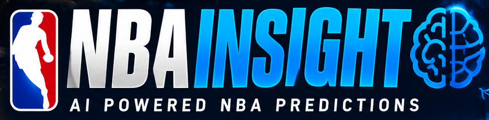
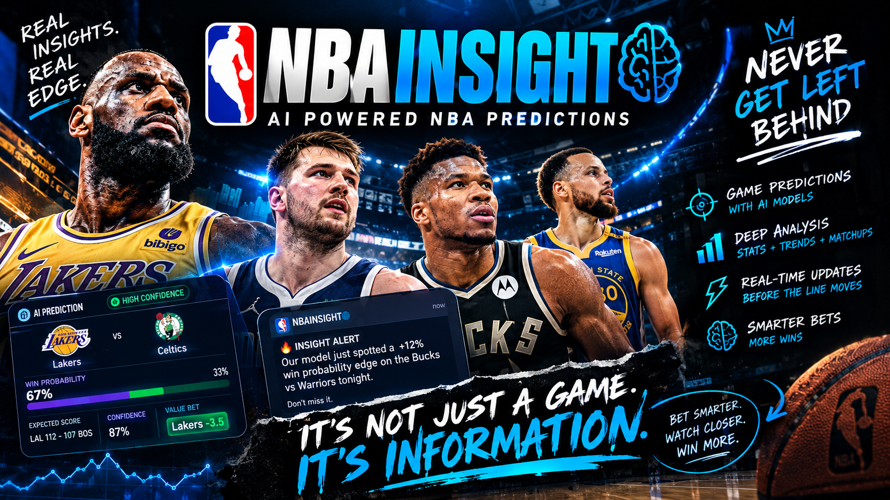
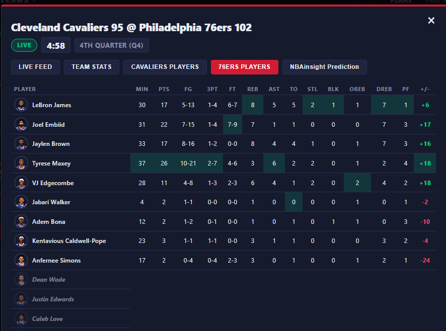
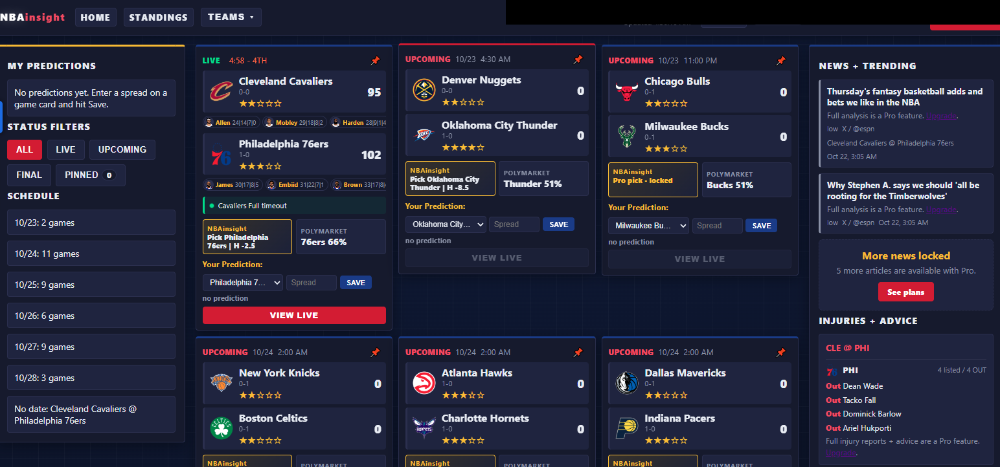
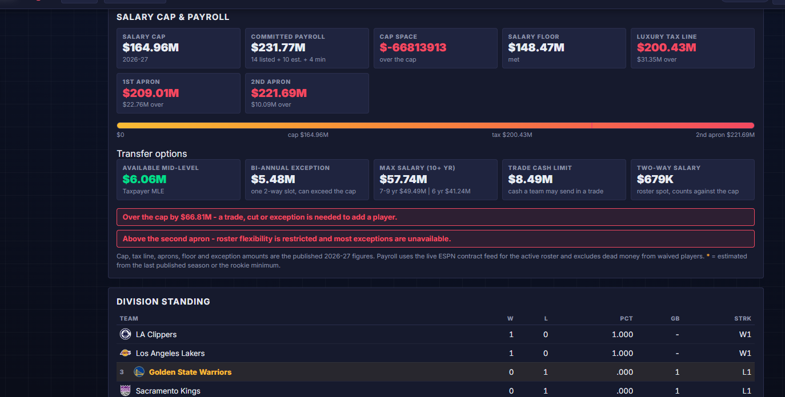
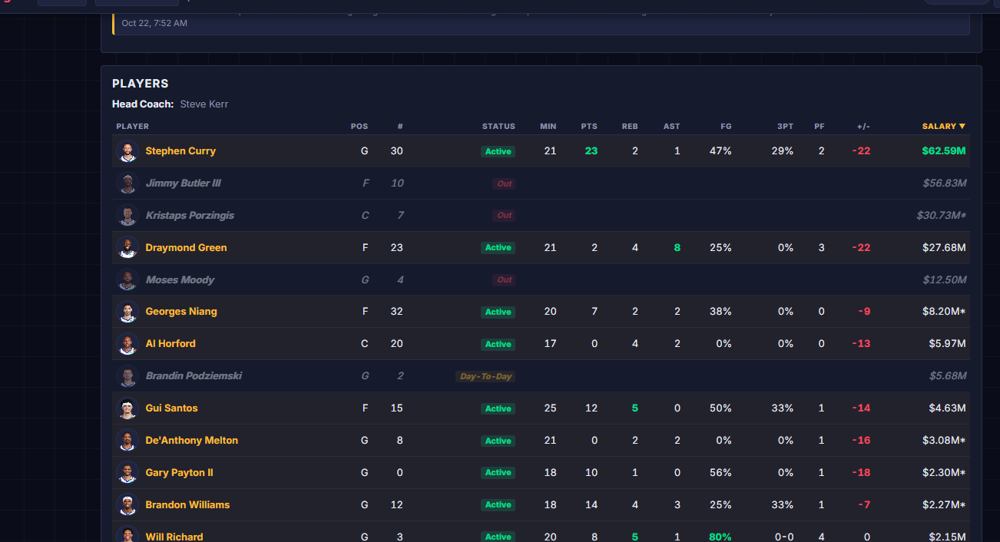

# NBA Insight

> **The market moves in seconds. NBA Insight moves first.**

**[Enter NBA Insight Now → nbainsight.com](https://nbainsight.vercel.app/)**

## Stop guessing. Start knowing.

NBA Insight is a live basketball intelligence platform built for people who want the edge before the edge disappears. It fuses **real-time NBA data**, **AI-driven modeling**, **mathematician-grade projections**, **live odds**, **injury intelligence**, and **market movement** into one fast, clean, decision-ready experience.

No tab overload. No stale takes. No "trust me bro" picks.

Just the signal.

## Why people get FOMO

- **Live scores, clocks, and slate tracking** while games are actually happening
- **Full play-by-play feeds** instead of waiting for a recap
- **AI model picks** with spread, total, confidence, and edge
- **Injury reports and betting advice** before the late scratches hit your lineup
- **Live odds and market pulse** while lines are still moving
- **Player prop projections** for points, rebounds, and assists
- **Parlay builder, exports, alerts, and API access** for power users
- **Pinned games and personalized watchlists** so your slate stays yours

If you are still refreshing five different sites, you are already behind.

## The edge stack

### Free
- Live scores, schedule, standings
- Team and player pages
- Card last-play line
- Limited play-by-play feed
- One model pick per day
- Two pinned games

### Pro — Courtside
- Full live play-by-play
- Every NBA Insight model pick
- O/U, confidence, win probability, and edge
- Full injury reports and advice
- Full live odds with no delay
- Unlimited pinned games
- No ads

### Elite — Front Office
- Everything in Pro
- Picks released 60 minutes early
- Player prop projections and model edges
- Line-move and injury alerts
- Model parlay builder
- Data export and API access
- Private community and priority support

## Built like a machine, not a blog

NBA Insight is powered by a serious intelligence layer:

- **Neural network-driven prediction systems** trained on massive basketball datasets
- **Latest-generation AI models** for probability, edge, and prop intelligence
- **Real-time inference pipelines** that react as games unfold
- **Advanced predictive engines** for spreads, totals, confidence, and market edges
- **Secure account and subscription infrastructure** for premium access
- **Global low-latency delivery** for an instant experience worldwide

The result is a platform that feels instant to users and dangerous to competitors.

## AI modeling + mathematician energy

This is not a highlight reel. NBA Insight is built around:

- Neural networks trained on historical and live basketball data
- Latest AI models for probability, edge, and prop intelligence
- Deep learning inference that reacts to game state in real time
- Advanced predictive engines for spreads, totals, and player props
- Market-aware intelligence for line movement and opportunity detection
- Continuous model evolution powered by modern machine learning systems

The goal is simple: turn noisy basketball data into a clearer, faster, more profitable decision.

## See the product

### Live product screenshots

## The unfair advantage

Most sites give you scores.

NBA Insight gives you:

- The pick
- The number
- The confidence
- The edge
- The injury context
- The market movement
- The live feed
- The reason

That is the difference between watching the game and attacking it.

## Start now

**[Go to nbainsight.com and get the edge →](https://nbainsight.vercel.app/)**

Free to start. Upgrade when you are tired of being late.

## Tech snapshot

`Neural Networks` · `Deep Learning` · `Machine Learning` · `AI Inference` · `Real-Time Analytics` · `Predictive Modeling` · `Prop Intelligence` · `Market-Aware AI`

---

NBA Insight is a basketball intelligence and analytics experience. It is designed for information, modeling, and user decision support. Always bet responsibly.
